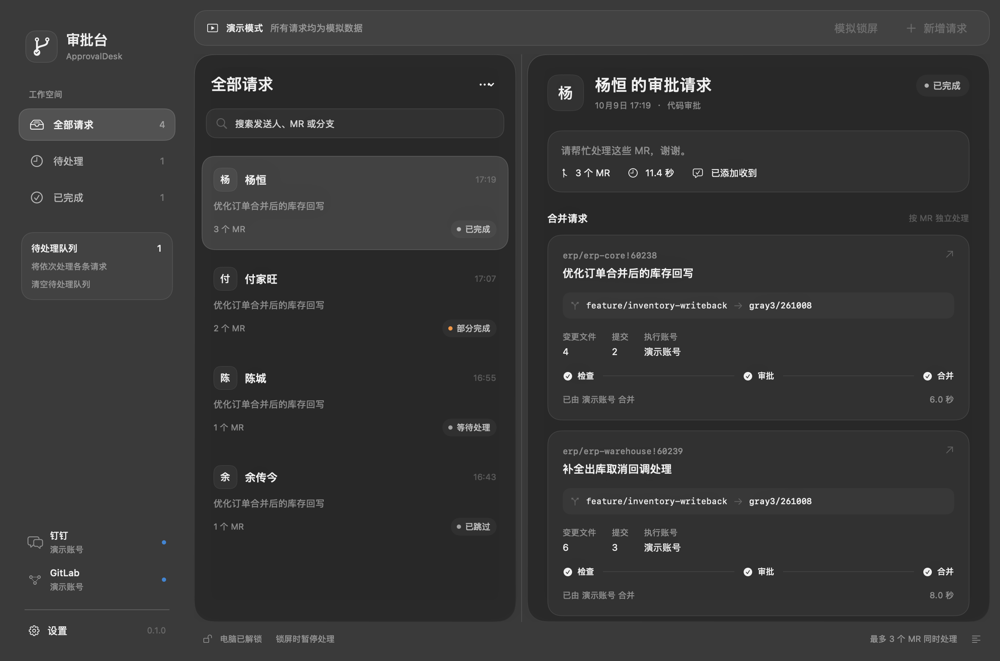

# 审批台 · ApprovalDesk

[](https://github.com/NotoChen/ApprovalDesk/actions/workflows/macos.yml)
[](https://github.com/NotoChen/ApprovalDesk/releases/latest)

原生 macOS 钉钉与 GitLab 审批助手。常驻菜单栏，自动接收审批请求，展示每个 MR 的审批、合并结果及发送人头像。SwiftUI + AppKit 提供透明磨砂界面，macOS 26 及以上使用系统 Liquid Glass。



## 下载与安装

前往 **[GitHub Releases](https://github.com/NotoChen/ApprovalDesk/releases/latest)**，下载与你的 Mac 匹配的 DMG：

| Mac 类型 | 安装包文件名 |
| --- | --- |
| Apple Silicon（M 系列） | `ApprovalDesk-版本号-macos-arm64.dmg` |
| Intel | `ApprovalDesk-版本号-macos-x86_64.dmg` |

要求 **macOS 14 或更新版本**。打开 DMG，将「审批台.app」拖入 Applications，然后打开应用。也可以下载同架构的 ZIP，解压后把应用移入 Applications。应用已包含 Python、DWS 和 glab，无需单独安装运行组件。

当前安装包使用临时签名，未经过 Apple 公证。首次下载若被 macOS 拦截，请在「系统设置 → 隐私与安全性」中选择「仍要打开」。

默认启动后只显示菜单栏图标，不弹出工作台，也不在 Dock 常驻。从菜单栏打开设置，完成以下配置：

1. 在「连接与账号」中登录钉钉与 GitLab。已有 DWS/glab 登录状态可直接复用。
2. 在「消息来源」中查询并选择审批请求群和人员来源群，确认 GitLab 地址。
3. 根据需要设置锁屏、暂停、排队、回执和通知策略，然后开始监听。

应用默认自动检查当前账号并开始监听；首次使用尚未登录时，可在设置中完成登录再开始。更新时退出旧版并替换 App，已有配置会继续保留。

## 功能

- **按群与人员筛选**：接收审批群内 @自己的请求，仅处理人员来源群允许成员发送的消息，支持一条消息中的多个 MR。
- **逐个 MR 展示结果**：保留检查、审批、合并步骤、分支、执行账号、实际合并人及正确的 GitLab 跳转地址。
- **核验合并结果**：遇到合并接口拒绝时重新检查 MR 状态，已经被他人合并的请求会展示真实合并人。
- **真实头像**：通过 DWS 人员检索获取头像，按钉钉身份精确匹配，异步加载和缓存；支持 JPEG、PNG 原图及完整图片地址。
- **监听期间可改群聊**：查找、选择和保存群聊独立于监听。同群重选、只查找后取消不会误报需要重新监听；实际切换会提示下次监听生效。
- **完整处理策略**：锁屏、手动暂停、新消息排队或丢弃、队列溢出、并发数、超时、重试与回执条件均可配置。
- **原生桌面体验**：独立设置窗口、原生左上角关闭按钮、深浅色、登录启动、通知定位请求与统一应用图标。

应用图标、菜单栏与侧栏共用「合流＋勾选」标志。应用图标保留玻璃底座；菜单栏使用透明单色模板，适配系统背景。暂停和异常只调整下方节点里的符号。[浅色图标](docs/previews/icon-family-light.png) · [深色图标](docs/previews/icon-family-dark.png)。

## 默认行为

| 项目 | 默认值 |
| --- | --- |
| 手动暂停期间的新消息 | 直接丢弃 |
| 锁屏暂停期间的新消息 | 直接丢弃 |
| 锁屏时是否继续处理 | 关闭，可独立开启 |
| 队列已满 | 移除最早尚未开始的消息 |
| 添加「收到」 | 全部成功，且包含本人完成的合并 |
| 登录 Mac 后启动 | 开启 |
| 打开应用后自动监听 | 开启 |
| 打开应用时显示工作台 | 关闭 |

已有自定义设置优先，更新应用不会重置这些选项。账号与消息来源的更改在下一次监听时应用；暂停、锁屏和新消息处置策略即时应用；并发、回执和重试参数在下一条消息开始时读取。

## 配置与运行组件

配置使用普通 JSON，路径为：

```text
~/Library/Application Support/ApprovalDesk/settings.json
```

应用不使用钥匙串。DWS/glab 继续管理已有登录状态，应用中填写的 Token 保存在配置文件中。任务历史、队列和运行详情保存在内存，退出后清空。

DWS 的配套运行库会展开到应用支持目录下按版本区分的 Components 中，应用包保持不变。安装包内的 `Contents/Resources/components.json` 记录 Python、DWS 和 glab 版本及来源校验值，第三方组件许可位于同目录下的 `Licenses`。

## 从源码构建

需要 Mac、Swift 工具链和 [uv](https://docs.astral.sh/uv/)。完整 Xcode 建议使用 26.3 或更新版本；Command Line Tools 构建在本机有兼容 SDK 时也可使用。原生发行版本覆盖 Apple Silicon 和 Intel，在对应架构的 Mac 上分别构建。

```sh
uv python install
APPROVALDESK_PYTHON="$(uv python find --managed-python)"
"$APPROVALDESK_PYTHON" -B scripts/prepare_components.py
"$APPROVALDESK_PYTHON" -B scripts/build_app.py --configuration release --zip --dmg \
  --components-dir ".cache/build-components/$(uname -m)"
"$APPROVALDESK_PYTHON" -B scripts/check_bundle.py --app dist/审批台.app --archives-dir dist
```

构建产物位于 `dist/`。运行组件版本和官方归档校验值固定在 `Resources/components.lock.json`，Python 版本同时由 `.python-version` 指定。

自动检查与模拟界面预览：

```sh
python3 -B -m unittest discover -s Tests/EngineTests -v
python3 -B scripts/check_models.py
python3 -B scripts/render_previews.py
```

安装完整 Xcode 后也可运行 `swift test -j 2`。本地测试和 CI 不需要业务账号，不会发送消息、执行审批或合并。详细说明见 [构建与验证](docs/testing.md)。

## 发布新版本

1. 更新 `Resources/Info.plist` 中的版本号和构建号。
2. 在 `CHANGELOG.md` 中加入对应版本的发行说明。
3. 提交并推送源码，再推送与版本号一致的标签，例如 `v0.2.0`。

GitHub Actions 会分别构建和验证两种 Mac 架构。全部通过后，自动公开对应 Release，包含两个 DMG、两个 ZIP 和 `SHA256SUMS.txt`。应用版本、引擎版本、组件清单、文件名与版本标签保持一致；不一致时发布会停止。已公开的同版本安装包不会被覆盖。

更多界面：[浅色工作台](docs/previews/workspace-light.png) · [消息来源](docs/previews/settings-sources-light.png) · [执行与队列](docs/previews/settings-execution-dark.png) · [菜单栏面板](docs/previews/menubar-dark.png)。仓库中的界面截图均为模拟请求预览。
